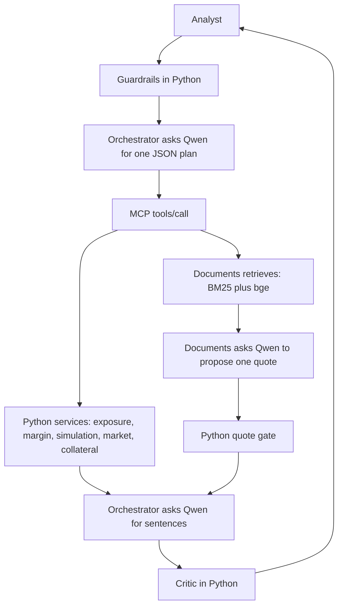

# RiskSphere

RiskSphere is a counterparty-risk desk for a synthetic six-name book. An analyst types a question in the console. The system answers with a figure, a clause, or a draft file a person can review. It does not send a margin call, approve one, book a trade, or change a stored limit.

The design rule is fixed. A language model reads language: it plans the question, it reads one retrieved clause when the question asks for an agreement number, and it phrases the answer. Python computes every risk figure and decides whether a quote is real. A draft stays a draft until a person signs it.

## Problem

A collateral and counterparty desk spends its day on a small set of questions. What is the exposure today? Is the name through its limit? What margin is due? What does the agreement say the threshold is? What happens if equities fall? Those answers have to be traceable. A wrong number, or a sentence that invents one, is worse than no answer.

A small chat model is a poor calculator. It rounds, it mixes today's exposure with a simulated future exposure, and it will quote an agreement sentence it was never shown. It is useful at reading the question, choosing which calculation to run, reading a passage it was given, and writing a short note once the numbers exist.

RiskSphere splits the work that way.

- The book is illustrative. Six names, with trades and agreement terms written for the project. Each limit is set from that name's simulated collateralised peak. Real books are confidential, and none are used.
- Prices are live. Two years of Yahoo daily closes, marked from the last close. If Yahoo does not answer, the question stops. An older saved close is not substituted.
- Public filings are downloaded from EDGAR, plus the BCBS margin text. A term taken from an agreement is verified only when the quote is in the file. The labelled retrieval set is still the sample clause pile, so that score stays comparable.
- The future-exposure number is a prototype simulation. It is not Basel SA-CCR. The initial-margin number is a proxy. It is not ISDA SIMM. Expected loss uses a synthetic probability of default and loss given default. It is not regulatory exposure at default, and those rates are not inferred from a company name.

## The book

Six names. The limit for each name is `round(max(peak, 1) × factor, -5)`, and if that rounds below 100,000 the limit is 100,000. The peak is the simulated collateralised potential future exposure from the live Yahoo history. A factor below 1 puts the simulated peak above the limit on purpose, so the status check has a breach to find. Kaveri's peak came out at 0 on the simulation; the floor exists so the status check still has a denominator.

| Id | Name | Peak (USD) | Factor | Limit (USD) |
| --- | --- | --- | --- | --- |
| CP-001 | Apex Capital Derivatives | 1,777,289 | 1.50 | 2,700,000 |
| CP-002 | Meridian Global Trading | 3,481,034 | 0.85 | 3,000,000 |
| CP-003 | Vanguard Risk Arbitrage | 683,774 | 1.10 | 800,000 |
| CP-004 | Zenith Hedge Fund LLC | 542,094 | 0.70 | 400,000 |
| CP-005 | Kaveri Commodities Pte | 0 | 1.40 | 100,000 |
| CP-006 | Marina Sovereign Fund | 1,246,800 | 1.15 | 1,400,000 |

Probability of default and loss given default are stored numbers on the book. They are synthetic. The model is not allowed to infer them from a company name.

## Design

Five stages, all runnable from the console.

| Stage | What the analyst can ask | Who does the work |
| --- | --- | --- |
| 1 | Today's exposure, variation margin, a Yahoo price or volatility, one cell of the haircut schedule | Python services |
| 2 | Simulated potential future exposure against the stored limit, after engine checks | Python, Simulation |
| 3 | Data quality, scenario profit and loss, an initial-margin proxy, collateral shortfall or surplus, synthetic expected loss | Python services |
| 4 | What an agreement or the schedule says; a draft change to a stored term | Documents, the second agent. Retrieval is BM25 plus embeddings. Qwen proposes one term. Python runs the quote gate. A person signs before the book changes |
| 5 | Alerts, an Excel daily pack, a Word margin notice, a stress workbook, a dispute sheet, and fan charts | Python writes the file. Nothing is sent |

Human sign-off is the boundary. A delivery or a return is flagged for a person. A term proposal and every stage-5 file are marked `DRAFT_PENDING_APPROVAL`. The console has no path that transmits them. The model cannot sign. A person applies one waiting draft with `approve <id> <field> by <name>`. The name must be at least three characters. That command writes a backup of the terms file, updates one field, and appends an audit row.

## Architecture

Two agents call Qwen. Six Python services do not.

An agent here means a role that calls the chat model and owns a decision about language. A Python service owns a formula or a file. The service does not plan, does not phrase, and does not call Qwen. The map from tool name to owner lives in one list, so the console log, the dispatcher, and this write-up stay on the same names.

| Piece | Kind | What it owns | Calls Qwen? |
| --- | --- | --- | --- |
| Orchestrator | Agent | Guardrails, the JSON plan, the wording, the critic | Yes. Plan, then wording |
| Documents | Agent | Hybrid retrieval, one reading of the retrieved passages, the quote gate, the draft term | Yes, and only to propose one term from passages already retrieved |
| Data quality | Python | Schema, ids, dates, units, signs. A bad row stops new figures | No |
| Market | Python | Yahoo spot and one-year volatility, scenario profit and loss, the stress workbook | No |
| Simulation | Python | Correlated Monte Carlo. The engine is checked before a named peak is quoted | No |
| Margin | Python | Variation margin from the agreement, the initial-margin proxy, the Word notice | No |
| Collateral | Python | One cell of the haircut schedule, then eligible value, shortfall, and surplus | No |
| Exposure | Python | Today's exposure against the limit, expected loss, alerts, the dispute sheet, the daily pack | No |

The console does not run the formulas itself. After the plan exists, each step is sent to a local tool server as an MCP `tools/call`. The transport is JSON-RPC 2.0, protocol `2024-11-05`, one JSON object per line. The server runs the Python and returns a JSON object. Server logs go to standard error so a log line cannot be parsed as a protocol message. Qwen never speaks MCP. The orchestrator does, after it already has the plan.



The reading step runs only when the plan came from Qwen and the question asks for a threshold, a minimum transfer amount, a rounding amount, or an independent amount. A schedule question stops at retrieval. A calculation question never enters Documents.

## How a question runs

The console is `python3 app.py`. It prints `RiskSphere ready` and waits. Nothing is calculated until a question is typed. An empty line, `quit`, or `exit` stops it. The same process remembers the last counterparty, so a follow-up that says "it" or "its" can reuse that name. A question over 1,000 characters is rejected.

Every question follows the same order. A later step does not start if an earlier step already stopped it.

1. **Guardrails, before any model call.** Six checks, in this order. The first failure stops the rest. There is no plan and no tool call.
   - Kill switch, if the process was started with it on.
   - Prompt injection: an attempt to ignore the rules, or to print the prompt or the key.
   - Personal data: an SSN, a passport, a home address, a personal phone.
   - An instruction to send, approve, release, book, pay, or change a limit, a trade, collateral, or a call.
   - Legal advice, including suing or terminating an ISDA.
   - Scope: the question must name a counterparty on the book, or contain a desk word such as exposure, margin, haircut, clause, or scenario.
2. **One plan call to Qwen**, only if every check passed. The model returns one JSON object: an intent, a refuse flag, a short reason, and at most four steps. Each step is a tool name and its arguments. The prompt tells it not to compute a number, and not to supply an agreement amount. Temperature is 0. The reply is validated before any tool runs. A repeated tool with the same arguments is skipped. If the reply is not a valid plan, or the gateway fails, keywords pick the steps and that failure is counted. The keyword path does not call Qwen, and the graded report is the live path.
3. **The tools, through MCP.** Yahoo is called only when a tool needs a price or a history. A haircut lookup does not call Yahoo. A refused question never gets here.
4. **One Documents reading, only for an agreement number.** If the plan came from Qwen and the question asks for a threshold, a minimum transfer amount, rounding, or an independent amount, Documents sends the retrieved `csa` passages to Qwen. Python then runs the quote gate. A draft is written only when the gate says `VERIFIED`. The number in the planner's JSON is not written. A question about the haircut schedule does not make this call.
5. **One wording call to Qwen**, only when the plan came from Qwen and at least one tool succeeded. The model is asked for three or four sentences that use figures already in the tool JSON.
6. **The critic, in Python.** It checks the sentences against the tool JSON. One rewrite is allowed. If the sentences still fail, they are dropped and the Python lines remain the answer.

The chat gateway allows one active request and 60 requests a minute. The plan, the Documents reading, and the wording share a lock, so they never overlap. A 429 or a 503 is retried after 2, 4, then 8 seconds. `max_tokens` is capped at 1,024. Each of the three prompts asks for 400. TLS verification stays on. The key is read from a local file that is not committed, and it is never logged.

## How the two agents are used

The orchestrator does not pick an owner by name. It picks a tool. The map then says whether Documents or a Python service owns that tool, and the console log names that owner while the tool runs. The owners do not talk to each other. They read the book, Yahoo, or the clause corpus, and they return JSON.

**Orchestrator.** It is the only agent that sees the raw question as a planning problem. It runs the guardrails, asks Qwen for the plan, dispatches the tools, asks Qwen for the sentences, and runs the critic. It owns no formula. On a calculation question this is two Qwen calls: plan, then wording. On a refusal it is zero calls, because the guardrail stops before the plan.

**Documents.** It owns `search_clauses` and `propose_term`. Retrieval does not call Qwen. Ranking is BM25 plus the embedding model. Qwen is called after that ranking, and only when the question is asking for one of the four agreement numbers. The model must return a field, a passage id, one amount, and a quote copied from one hit. Python checks the quote. `propose_term` then writes a draft row with status `DRAFT_PENDING_APPROVAL` and `applied` false. If the quote is not in the hit, or the quote states several amounts, or the field is not one of the four numbers, no draft is written.

A question can plan up to four tools. "Is Zenith Hedge Fund LLC in breach?" might check data quality and then today's exposure. "What does the haircut schedule say about gold?" goes to Documents for retrieval only. "What threshold does the agreement give Meridian Global Trading?" goes to Documents for retrieval and then for the Qwen reading.

The batch term sheet over the downloaded filings does not use this reading. A pattern finds the sentence, and the same quote gate decides the cell. Green is verified, yellow needs a person, grey was not found. Sending every filing through Qwen would not change what counts as verified, and it would sit on the one-request gateway.

What each calculation actually is:

- Today's exposure is quantity times (last close minus entry), summed, minus eligible collateral, floored at zero, then compared with the stored limit. Utilization over 100% is BREACH. From 85% inclusive it is WARNING. Otherwise OK. The status uses the unrounded ratio.
- Variation margin uses the agreement. Credit support is the larger of zero and (mark plus independent amount minus threshold). A delivery rounds up to the rounding step, a return rounds down, and an amount below the minimum transfer amount is `NO_ACTION`. An exact multiple of the step is left as it is.
- The future-exposure simulation is correlated geometric Brownian motion with no risk-free drift. The correlation is the sample correlation of the Yahoo returns, factored with Cholesky. The peak is the maximum over time of the 95% quantile of collateralised exposure. Collateral is lagged by a margin period of risk. Posted cash is not an input. The book run uses 2,000 paths, seed 7, and a horizon cap of 126 steps. Before a named peak is quoted, the engine is checked on a throw-away book: closed form at several horizons, collateral must not raise the peak, a huge threshold turns collateral off, offsetting trades net, and a one-day margin period cuts the collateralised peak.
- Scenario profit and loss reprices the equity and FX trades under a stored shock: equity down 20%, equity down 40%, or EURUSD down 10%. A trade the shock does not name stays at today's mark.
- The initial-margin proxy is `z × sqrt(max(δᵀ (σσᵀ ⊙ R) δ, 0) × H)` with H = 10 days and z the inverse normal at 99%. It is a different number from the variation-margin call, and it is not SIMM.
- Collateral coverage is face amount times (1 minus the haircut). An asset with no schedule cell counts as zero. Eligible value minus the requirement is a surplus or a shortfall.
- Expected loss is synthetic PD times LGD times an exposure. The exposure is today's figure, or the simulated future figure when the question asks for that. The label says which. Neither figure is regulatory EAD.
- Stage-5 tools write a file and mark it as a draft. Alerts cover a breach, a collateral shortfall, and a price older than five days. A dispute row agrees when the gap is within the larger of the rounding step and 1% of our mark. Otherwise it needs their mark.

The haircut table in the code is the desk schedule: cash 0, government bonds 1–5y AAA–AA− at 2%, corporate bonds over 5y A+–BBB− at 12%, main-index equity 15%. The BCBS text is stored beside that table. It does not replace the table, and the table has not been spot-checked against the PDF.

## How retrieval is used

Retrieval is the tool `search_clauses`, owned by Documents. The planner calls it when the question is about what an agreement or the haircut schedule says. It is not a side path around the orchestrator, and a hit does not change a stored term.

Two corpora stay apart.

The labelled corpus is 24 short sample passages in `data/clauses.json`. Each has an id, a title, a pile, and an optional counterparty. The console searches this corpus, and the retrieval score is computed on it, so the score stays comparable from run to run. A question searches one pile. The console returns the top 3. The labelled evaluation scores the top 5.

- `csa` is the agreement pile: threshold, minimum transfer, rounding, independent amount, eligible collateral, valuation, netting, dispute. Sample passages for Meridian are tagged CP-002. Sample passages for Apex are tagged CP-001.
- `d499` is the haircut-schedule pile: cash, government bonds, corporate bonds, equity, gold, and a currency-mismatch add-on.

The filing corpus is separate. It is the downloaded EDGAR text used by the term-sheet extractor. It is not mixed into the 24-query retrieval score. The download asked for 500 credit-support exhibits, 300 contracts, and 150 disclosure excerpts. The folders now hold 522 credit-support texts, 278 contracts, 150 disclosures, and the BCBS margin text. The credit-support count is higher because annexes found during the contract search were saved with the credit-support files. The contract search stopped at 278 when the year and query list ran out.

Two rankings are built on the labelled pile and then fused.

- **BM25** is Okapi BM25 with k1 = 1.5 and b = 0.75. Tokens are lower-case words. A short stop list is dropped. For a query term against passage i of length Lᵢ, with N passages in the pile and average length L̄,

  IDF(t) = log(1 + (N − df(t) + 0.5) / (df(t) + 0.5))

  score(t, i) = IDF(t) × (tf × (k1 + 1)) / (tf + k1 × (1 − b + b × Lᵢ / L̄))

  Rare shared words count more than words that appear in every passage. A passage that shares no query word scores 0 and does not enter the ranking.

- **Dense** embeds the query and each passage with `bge-small-en-v1.5` and scores them by cosine similarity. Vectors are 384 numbers. A batch holds at most 16 texts. Vectors are cached on disk, keyed by the model name and the exact text, so a passage is embedded once.

- **Reciprocal rank fusion** adds the rankings without putting BM25 and cosine on one scale. Each signal contributes its top 10. A passage at rank r, with r starting at 1, contributes 1 / (60 + r). A passage both signals like floats up. If the embedding call fails, the lexical ranking is used alone and the result says so.

The hits are tagged `S1`, `S2`, `S3` in the order fusion returned them. The wording may cite a tag only if that tag was returned, and a phrase in double quotes must appear inside the cited passage. The critic enforces both.

## How the quote gate is used

The gate is Python. The model does not assign `VERIFIED`.

A record is `VERIFIED` only when both of these hold. The quote is in the document, ignoring curly quotes and other typography, and allowing an ellipsis to split the quote into pieces. And the quote states exactly one amount, and that amount is the amount on the record.

A quote that is not in the file is `REVIEW`. A quote that states several amounts is `REVIEW`, because a person has to pick which amount belongs to the field. A missing quote is `NOT_FOUND`.

On the interactive path the "document" is the retrieved passage. Documents asks Qwen for the quote, the gate runs on that passage, and `propose_term` writes a draft only for `VERIFIED`. `propose_term` checks again that the number appears in the passage as its own amount, so a bare `1` cannot match inside `1,000,000`. The stored agreement is not edited.

On the batch path the document is the downloaded filing. A pattern proposes the quote. The same gate paints the workbook. That path does not call Qwen.

## How Qwen is used

The chat model is `Qwen/Qwen3-8B` on the group gateway. It is called in three roles. The critic is not one of them.

| Call | Who | When | What it must do | What it must not do |
| --- | --- | --- | --- | --- |
| Plan | Orchestrator | After the guardrails pass | Return one JSON plan of at most four tool steps | Compute a dollar figure, invent a tool, supply an agreement amount, or exceed four steps |
| Reading | Documents | After retrieval, and only for an agreement number | Return one field, one passage id, one amount, and a quote copied from one hit | Calculate, invent a number, or include a second amount in the quote |
| Wording | Orchestrator | After a Qwen plan and at least one successful tool | Write three or four sentences from the tool JSON | Introduce a number, a status, or a citation that is not in that JSON |

A schedule question makes the plan call and the wording call. A calculation question does the same. An agreement-number question adds the reading between them. A guardrail refusal makes none of the three. One rewrite of the wording is allowed when the critic objects, so a hard question can reach four chat calls. The gateway still sees one request at a time.

Every call prepends `/no_think` and the language rule, so the model does not spend the reply on a thinking trace. Any think-tags that still appear are stripped. Temperature is 0. The reply has to be English. Characters outside that rule are removed from the plan text and from the wording before they are shown.

Qwen is not used to embed text, to mark the book, to talk to Yahoo, to rank passages, or to decide whether a sentence is grounded. Those are the embedder, the Python services, and the critic.

## How the embedder is used

The embedding model is `bge-small-en-v1.5` on a different gateway from the chat model, with its own key and its own certificate. A request is `POST /v1/embeddings` with a JSON body of `model` and `input`. Each vector is 384 numbers. A batch holds at most 16 texts. The same model embeds the passages and the query. A 429 or a 503 waits 2, 4, then 8 seconds, the same as the chat gateway.

The embedder does not see the chat prompt, does not choose a tool, and does not write the answer. Its only output is vectors. Cosine similarity turns those vectors into the dense ranking, which fusion combines with BM25.

If the embedding key, the URL, or the certificate is missing, retrieval still runs. The mode on the result is lexical BM25, and the miss is logged. The chat key is not reused for this gateway.

## Prompts

Every chat call starts with these two lines, then the prompt for that role.

```
/no_think
English only. Use ASCII letters. Do not use Chinese, Japanese, or Korean characters.
```

The braces in the prompts below are filled at call time. They are not left for the model to guess.

### Plan prompt

`{names}` is the book, as `Name = CP-00N`. `{last_counterparty}` is the remembered id, or `none`. `{asset_classes}`, `{maturity_buckets}`, `{rating_buckets}`, and `{scenario_names}` come from settings. `{question}` is the analyst's text.

```
You are the planner for RiskSphere. Stages 1 to 5.
Reply with one JSON object and no other text.
Write reason and refusal_reason in English only. Do not use Chinese characters.
Do not compute any number.
{"intent":"exposure","refuse":false,"refusal_reason":"","reason":"why these steps fit this question","steps":[{"tool":"current_exposure","args":{"counterparty":"meridian"}}]}
refuse is true only when the user wants something sent, approved, booked, or a limit changed. A draft file is allowed. Changing the stored book is not.
steps has at most 4 objects. tool is one of: current_exposure, calculate_margin_call, get_market_data, regulatory_haircut, check_pfe_limit, check_data_quality, scenario_pnl, initial_margin_proxy, collateral_coverage, expected_loss, search_clauses, propose_term, list_alerts, draft_report, draft_margin_notice, draft_stress_book, draft_dispute.
current_exposure(counterparty): today's mark against the stored limit. This is not potential future exposure.
check_pfe_limit(counterparty): simulated potential future exposure against the stored limit. Use this when the question says PFE, future exposure, or potential future. Do not also call current_exposure unless the question also asks about today.
calculate_margin_call(counterparty): threshold, minimum transfer amount, haircut, delivery or return. Do not use this for a question about what the agreement text says.
get_market_data(ticker): Yahoo spot and one-year volatility. ticker examples: SPY, SHY, LQD, EURUSD=X.
regulatory_haircut(asset_class, maturity_bucket, rating_bucket): the haircut table. asset_class is one of {asset_classes}. maturity_bucket is one of {maturity_buckets}. rating_bucket is one of {rating_buckets}.
check_data_quality(): no arguments. Use when the question is about missing fields, the schema, or whether the book is complete.
scenario_pnl(counterparty, scenario): repriced profit and loss. scenario is one of {scenario_names}.
initial_margin_proxy(counterparty): illustrative initial margin. Not SIMM. Not the variation-margin call.
collateral_coverage(counterparty): eligible collateral, shortfall, surplus.
expected_loss(counterparty, ead_basis): synthetic PD times LGD times EAD. ead_basis is current or pfe. Use pfe only when the question asks for future exposure as the EAD.
search_clauses(query, pile): sample sentences. pile is csa or d499. Use csa for agreement wording and d499 for the haircut schedule text. query is the user question. Do not invent a quote.
For a threshold, minimum transfer amount, rounding, or independent amount in the agreement text, call search_clauses with pile csa. Do not call propose_term and do not supply a number. Documents reads those hits and proposes the term.
list_alerts(): no arguments. Breaches, shortfalls, stale prices.
draft_report(counterparty, include_pfe): draft report. include_pfe is true only when the question also wants the simulation in the report.
draft_margin_notice(counterparty): draft notice. It is not sent.
draft_stress_book(counterparty): draft stress table. counterparty may be empty for the whole book.
draft_dispute(counterparty, their_mtm): their_mtm is a number already written in the question. Do not invent it.
Names: {names}. counterparty is the id. If the user says it or its, use {last_counterparty}.
Question: {question}
```

The example JSON at the top is the schema, not a few-shot of a real book answer. The tool blurbs are there because an 8B model otherwise confuses today's exposure with the simulation, and a question about agreement wording with the margin formula. The line that forbids `propose_term` is there so the planner does not invent the threshold. Documents reads the passage and Python checks the quote. If the model emits `propose_term` anyway, that step is not executed. Documents reads the hits instead, and the planner's number is discarded.

### Documents reading prompt

`{question}` is the analyst's text. `{passages}` is at most three hits, each as `[S1] id=...` followed by the passage text, cut at 700 characters.

```
You are Documents for RiskSphere. Read the passages and propose one agreement term.
Reply with one JSON object and no other text.
{"field":"threshold","passage_id":"the id of the passage you copied from","value":1000000,"quote":"exact words copied from that one passage"}
field is one of threshold, mta, rounding, independent_amount.
value is the single amount stated in the quote. Write it as digits. One million is 1000000. Zero is 0.
The quote must be copied from the passage. Do not include a second amount in the quote.
If the passages do not state one amount for one of those fields, return {"field":"","passage_id":"","value":null,"quote":""}.
Do not calculate. Do not invent a number that is not written in the passage.
Question: {question}
Passages:
{passages}
```

The example amount in that prompt is the shape of the JSON, not a number the model is allowed to copy when the passage says something else. The gate rejects a quote that is not in the hit.

### Wording prompt

`{tool_result}` is the JSON from the tools that succeeded, including a Documents reading when one ran. `{question}` is the same analyst text.

```
Write three or four short sentences for a risk analyst.
Write in English only. Do not use Chinese characters.
Use only figures, statuses, and tickers that appear in the tool result. Do not recompute.
If status is BREACH, do not say the name is within its limit.
If the tool result has action NO_ACTION, say there is no margin call. If it has no action field, do not mention a margin call.
If delivery_amount_usd or return_amount_usd is above zero, say a person still has to review this before any collateral moves. If those fields are absent, do not say that.
Do not mention files or fields that are absent. If the tool is check_pfe_limit, call the peak a simulated potential future exposure and quote peak_pfe_collateralized_usd and status. Say it is not today's exposure. If the tool is current_exposure, do not call that figure potential future exposure.
If the tool is scenario_pnl, quote scenario_pnl_usd and scenario_label.
If the tool is initial_margin_proxy, quote initial_margin_usd, horizon_days, and percentile, and say it is not SIMM.
If the tool is collateral_coverage, quote shortfall_usd and surplus_usd.
If the tool is expected_loss, quote expected_loss_usd and say the EAD is the ead_label, not regulatory EAD.
If the tool is search_clauses, cite the hit you used by its source tag in square brackets, like [S1], and any phrase in double quotes must appear in that hit text. Do not cite a tag that is not in the hits. Do not say the stored book was changed.
If the tool name starts with draft_, say it is a draft and that nothing was sent.
Question: {question}
Tool result:
{tool_result}
```

If the critic rejects the first draft, the same prompt is sent again with one extra line naming the failures. That is the only rewrite.

### What the critic checks

The critic is not a model call. It reads the sentences and the tool JSON.

- A large number in the sentences must appear as a contiguous run of digits in the tool JSON. A comma-grouped number has to match that run. This check is strict and sometimes rejects a true figure: `USD 1,000,000` in the tool JSON can be seen as the run `000`, and a rate such as `1.096972` can be chopped so that `096972` looks ungrounded. When that happens the sentences are dropped and the Python lines remain.
- BREACH cannot be described as within the limit, and OK cannot be called a breach.
- A future-exposure answer must quote the peak and the status. A today's-exposure answer must quote the exposure and the status.
- A margin amount must be quoted when one exists. A zero call must say there is no call. A sentence about a margin call is rejected when the margin tool did not run.
- A haircut percent and a spot must show up when those tools ran.
- A quoted phrase must sit inside a returned passage. A source tag such as `[S1]` must be one of the returned tags.
- A verified Documents reading must quote the draft amount. The wording must not say the stored agreement was changed. `applied` is false.
- The words SIMM, SA-CCR, and regulatory EAD are rejected unless the sentence says the figure is not those things.
- A draft tool's wording must say the file is a draft.

## How it is evaluated

`python3 report.py` is the graded run. Qwen plans and phrases the frozen question set. The embedder scores retrieval. The draft-term tool is exercised through the same MCP server. The write-up and the per-question tables land in `outputs/`. The frozen questions ask what the schedule says, not for an agreement number, so that run does not exercise the Documents reading. The reading is checked, with the model off, in the corner suite: a copied quote with one amount is verified, a quote that is not in the passage is not, two amounts stay for a person, and the check itself writes nothing.

### The agent set

Twenty-seven questions, frozen before the run, each with a gold tool or a gold refusal. Near-duplicate questions were removed. Categories cover exposure, margin, market data, haircuts, the simulation, data quality, scenarios, the initial-margin proxy, coverage, expected loss, the schedule text, alerts, the report, the notice, the stress book, the dispute, and five refusal classes: action, injection, personal data, legal, and scope.

For each question the harness records the tools in the plan, whether the question was refused, whether any tool errored, whether wording survived the critic, the retrieval mode when a clause search ran, the latency, and the token use.

| Number | Rule |
| --- | --- |
| End-to-end accuracy | The refusal matched the gold, and, for a work question, the gold tool is among the tools that ran |
| Routing accuracy | The same pass rule on this set, so it matches end-to-end |
| Refusal accuracy | The system refused exactly when the gold said to refuse. A wrong tool still passes, because the question correctly was not refused |
| Task completion | A refusal happened when required, or a tool ran without error. The tool does not have to be the gold tool |
| Average tool calls | Steps in the plan, including zero for a refusal, divided by the number of questions |
| Latency p50 / p95 | Wall-clock time of the question, sorted, with linear interpolation |
| Chat calls and tokens | Successful gateway replies, and the gateway's own prompt and completion counts, summed |
| Wording kept / dropped | The critic accepted the sentences, or rejected them and left the Python lines |

On the live run of 22 Nov 2026 at 14:42 the set scored 25/27 end to end, 27/27 task completion, and 27/27 refusal accuracy. Qwen made 50 chat calls, 39,867 prompt tokens and 3,163 completion tokens. Latency was 3.539s at p50 and 8.986s at p95. All 21 work plans came from Qwen as valid JSON. Two plans chose a neighbouring tool. "Is Zenith Hedge Fund LLC in breach?" ran the alert list instead of today's exposure. "What does the haircut schedule say about gold?" ran the haircut table instead of clause search. The critic kept 13 wordings and dropped 8. The full rows are in `outputs/submission_report.md` and `outputs/eval_results_live.csv`. The draft-term exercise wrote a CP-002 threshold draft from passage `meridian-threshold`, proposed value 1,000,000, status `DRAFT_PENDING_APPROVAL`, `applied` false.

On that same run, BM25 recall@1 was 0.875, recall@3 and recall@5 were 0.917, MRR was 0.889, and nDCG@5 was 0.896. Hybrid recall matched. Hybrid MRR was 0.896 and nDCG@5 was 0.901. The dense signal moved one paraphrase up a place. "Bullion" and "shares" stayed outside the top 5 for both signals. The one clause search inside the question set used hybrid retrieval.

The question set calls 16 of the 17 tools. The seventeenth, the draft term proposal, is run once through MCP after the set. It writes a draft, status `DRAFT_PENDING_APPROVAL`, `applied` false. The stored agreement is not edited.

### The retrieval set

Twenty-four labelled queries, one relevant passage each, scored apart from whether the final wording was any good. The retriever returns the top 5. Rank is the position of the labelled passage, or 0 if it is missing.

| Number | Rule |
| --- | --- |
| Recall@k | Share of queries whose relevant passage landed at rank 1 through k |
| MRR | Mean of 1/rank, with rank 0 contributing 0 |
| nDCG@5 | Mean of 1/log2(rank+1) when the rank is 5 or better, else 0. A rank-1 hit scores 1 |
| lexical (bm25) | BM25 only |
| hybrid (bm25+dense) | BM25 fused with cosine over the live `bge-small-en-v1.5` vectors |

The retrieval numbers for the latest live run are in the same submission report. Literal questions already sit at rank 1 under BM25. The dense signal is there for a paraphrase that does not share the passage's words.

### Corner checks

`python3 corner_cases.py` does not call Qwen, the embedder, or Yahoo. It checks boundaries the frozen set does not isolate: the kill switch stops before later checks, a hypothetical margin question is still answered, an instruction to send is refused, status cuts at 85% and 100%, rounding on an exact step, haircut edges including an unknown asset, the agreement pile and the schedule pile staying apart, a draft amount the passage does not contain, an invented number, an unknown source tag, the quote gate, the Documents reading gate, the Office zip files, and the future-exposure engine checks. On 22 Nov 2026 that run passed all 49 checks.

## Terminology

| Term | What it means here |
| --- | --- |
| Agent | A role that calls Qwen. There are two: Orchestrator and Documents |
| Python service | Code that computes or writes a file and does not call Qwen |
| Orchestrator | Guardrails, plan, wording, critic |
| Documents | Retrieval, the reading call, the quote gate, the draft term |
| MCP | The local tool server. A step is a `tools/call` on JSON-RPC 2.0 |
| Guardrail | One of the six checks that can stop a question before any model call |
| Plan | The JSON object of at most four tool steps |
| Reading | The Documents call that proposes one quote from retrieved passages |
| Wording | The three or four sentences Qwen writes from the tool JSON |
| Critic | The Python check that drops a sentence the tool JSON does not support |
| Keyword planner | The fallback when Qwen is off or the gateway plan is invalid. Not used in the graded report |
| Quote gate | `VERIFIED`, `REVIEW`, or `NOT_FOUND`. Python assigns it. The model does not |
| DRAFT_PENDING_APPROVAL | The status on a term or a file that a person has not signed |
| applied | False until a person signs. The model cannot set it |
| Pile | One retrieval corpus. `csa` is agreement text. `d499` is the schedule text |
| Source tag | `S1`, `S2`, `S3` on the hits the wording is allowed to cite |
| BM25 | The lexical ranker. Okapi, k1 = 1.5, b = 0.75 |
| Dense rank | Cosine similarity of `bge-small-en-v1.5` vectors |
| RRF | Reciprocal rank fusion, k = 60, combining the two rankings |
| CSA | The credit-support terms: threshold, minimum transfer, rounding, independent amount |
| Threshold | Exposure below this does not require a delivery |
| MTA | Minimum transfer amount. A smaller delivery or return is no action |
| Independent amount | An extra amount in the credit-support formula. Not the initial-margin proxy |
| Haircut | The percent of face value that does not count as eligible collateral |
| Current exposure | Today's mark minus eligible collateral, floored at zero, against the stored limit |
| PFE | The simulated collateralised peak. A prototype. Not SA-CCR |
| MPOR | Margin period of risk. How many steps collateral lags the mark in the simulation |
| IM proxy | The 10-day 99% normal-loss figure. Not ISDA SIMM |
| EL | Expected loss, PD × LGD × exposure. The exposure is not regulatory EAD |
| PD / LGD | Synthetic probability of default and loss given default. Not inferred from a name |
| BREACH / WARNING / OK | Utilization over 100% / from 85% / under 85% |
| EAD | In this desk, the exposure basis of expected loss. Not a regulatory EAD |
| SA-CCR | The Basel standardised approach this simulation is not |
| SIMM | The ISDA initial-margin model this proxy is not |

## What a small model forced

- The model never computes. Exposure, margin, haircut, the simulation, the scenario, coverage, and expected loss are Python.
- The plan is one JSON object, checked before a tool runs. An agreement amount is not taken from that JSON.
- Documents may propose a term only by quoting a passage it was given, and Python can still reject the quote.
- Thinking mode is off. Temperature is 0. The reply has to be English.
- One request at a time, with retries and a token cap.
- A citation has to be a returned source tag, and a quotation has to sit inside that passage.
- A term change and every generated file stay drafts. Nothing is sent.
