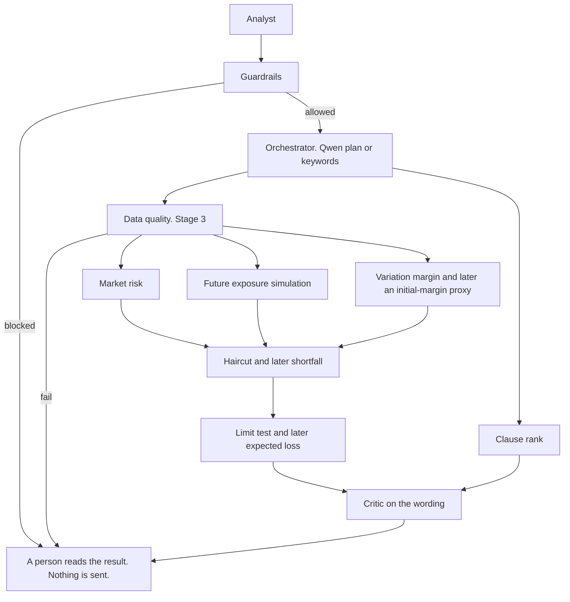
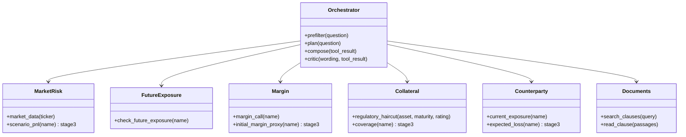
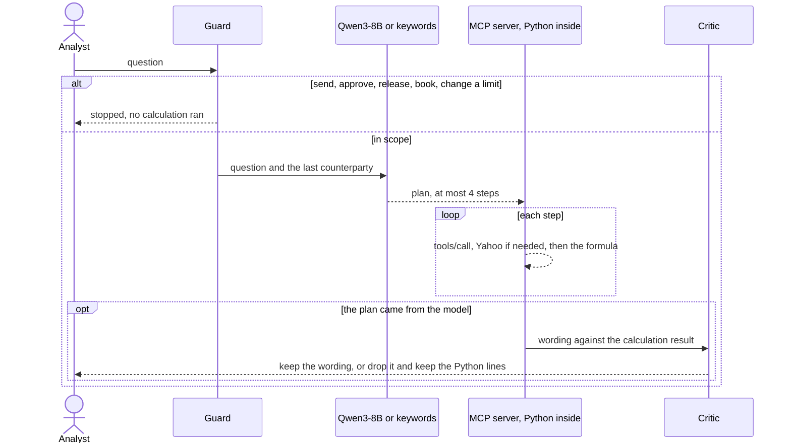
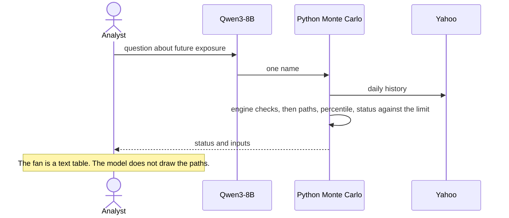
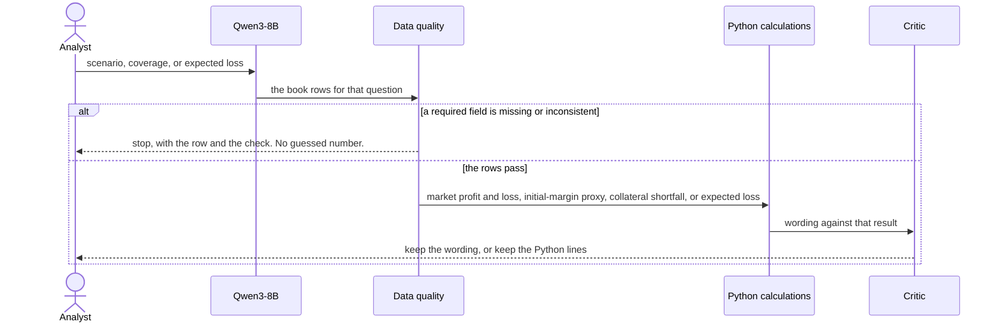
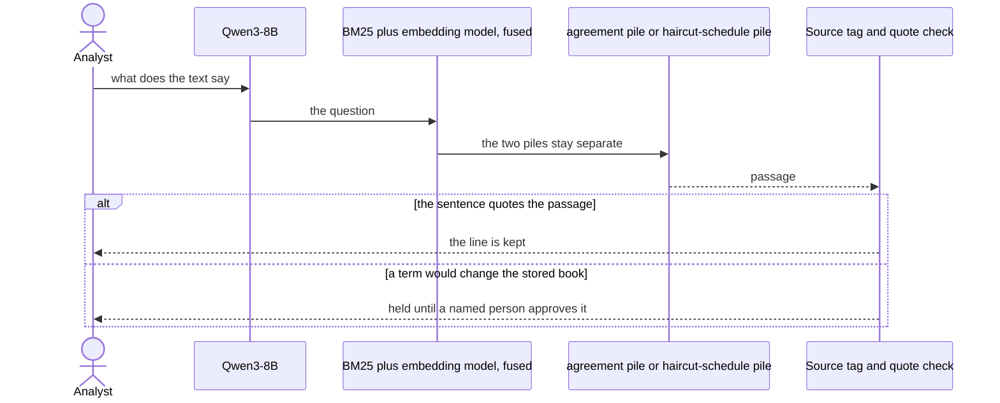
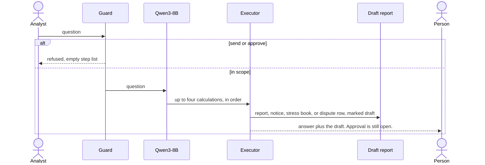

# RiskSphere

We built RiskSphere so we can ask questions about a small derivative book we made up. It can tell us today's exposure, a simulated future exposure, a margin amount, a haircut, a scenario, coverage, a credit number, a sample clause, and a draft. All five stages run from the console. We do not send a call, we do not approve one, and we do not book a trade. If the answer is a delivery or a return, a person still has to sign it.

The model plans the steps and, sometimes, writes the sentences afterwards. Python does the money. We do not give a formula its own model call.

## Where we are

**Stage 1 is today's book, and it runs.** We check the question before the model sees it. The checks are a kill switch, an attempt to override the rules, a request for personal data, an instruction to send or book, a request for legal advice, and whether the question is about this book at all. The first failure stops the rest. If the checks pass, Qwen3-8B returns a short plan: which calculation, and for whom, at most four steps. Python runs those steps. A second model call may phrase the result. We drop those sentences when a figure or a status word was not already in the calculation. If the chat gateway fails, we pick the calculation from keywords and we say the model was not called. The calculations are today's exposure, a margin call, a Yahoo price or volatility, and a regulatory haircut. The limit test here is today's exposure.

**Stage 2 is a simulated future exposure, and it runs.** We simulate the book forward with a correlated random walk, using the volatility and correlation in the Yahoo history. Variation margin sits inside the paths, lagged by a margin period of risk. The fan is a small table on the console. Before we quote a number for a real name, we check the engine on a throw-away book: a closed form at about one month, one quarter, half a year, and a year, collateral does not raise the future number, a huge threshold turns collateral off, two offsetting trades net, and a one-day margin period cuts the collateralised peak. We call this a prototype simulation. We are not computing Basel SA-CCR. Each credit limit is that name's simulated peak, times a factor, rounded. The paths do not spend the cash we posted on the book.

**Stage 3 is the rest of the risk numbers, and it runs.** A data check comes first: required columns, unique trade ids, dates, units, and sign. A bad row stops the calculation. The model does not invent a missing price, a probability of default, or a haircut. Then four calculations, each named on the result.

- Market risk for the equity and FX trades we can already mark. We store three shocks: SPY down 20 percent, SPY down 40 percent, and EURUSD down 10 percent. Scenario profit and loss is the shocked mark minus today's mark. A trade the shock does not name stays put.
- An initial-margin proxy. It is a normal loss quantile of the correlated dollar moves, 10 days, 99 percent. We do not call it ISDA SIMM, and it is a different number from the variation-margin call.
- Collateral coverage. Eligible value after the haircut, then a shortfall or a surplus against the credit-support amount. An asset that is not on the schedule counts as zero.
- Expected loss. We store a synthetic probability of default and loss given default on each name, horizon one year. Expected loss is those two times an exposure. The exposure is today's figure, or the simulated future figure when we ask for that, and the label says which. We do not call it regulatory exposure at default.

**Stage 4 is the text, and the retrieval is hybrid.** We download 500 credit-support filings, 300 contracts, and 150 disclosure excerpts from EDGAR, plus the BCBS margin text. A term taken from an agreement is verified only when the quote is in the file. The labelled retrieval set is still two piles of sample sentences: the agreement pile, and the haircut-schedule pile. A question ranks one pile with two signals. The first is a lexical score, BM25, that rewards rare shared words. The second is the hosted embedding model, when that key is set, which rewards meaning over wording. We fuse the two rankings with reciprocal rank fusion, so a passage both signals like floats to the top, and when the embedding key is absent the lexical score carries the ranking on its own. Each hit we return carries a short source tag, and the wording has to cite that tag and may only quote text that sits inside the cited passage, or the critic drops it. A proposed change to a threshold or a minimum transfer is written as a draft. The stored agreement is not edited.

**Stage 5 is the desk file, and it runs.** We raise an alert for a breach, a collateral shortfall, or a price older than five days. Python writes an Excel daily pack, a Word margin notice, a stress workbook, a dispute sheet, and a fan chart. Each file is a draft. Nothing is sent. "Send the notice" still stops at the action check.

**The graded score is a live run.** One command asks Qwen to plan and phrase the frozen quality set, with duplicate questions removed, asks the live embedder to score 24 labelled clause questions, and runs the draft-term tool. The write-up records end-to-end accuracy, task completion, routing, refusals, latency, token use, and where the critic dropped a sentence. Retrieval is reported on its own in that same run: Recall@1, @3, @5, mean reciprocal rank, and nDCG, so we can see where the lexical signal alone falls short and the embedding signal earns its place. A separate check, with the model off and no Yahoo call, walks the boundaries: guardrail order, a hypothetical that must still be answered, the 85% and 100% status cuts, rounding, haircut edges, the two clause piles, a draft the passage does not support, and a critic rejection.

## Deliverables

Four artifacts. The repository is the system. The other three are generated from it.

- **Git repository.** This tree is the system. Two agents call Qwen. The orchestrator plans and phrases. Documents retrieves clauses and reads one of them when the question asks for an agreement term. Python checks the quote and owns the calculations and the desk files. The console sends each step to a local MCP server. Retrieval, the critic, the frozen questions, and the corner checks live in the same tree.
- **Trace dashboard.** Every finished question is appended to the trace log: the text, the plan, the tools, the flags, and the latency. The prompt and the key are not stored. `python3 trace_dashboard.py` writes `deliverables/trace_dashboard.html`. Open that file in a browser. The rows are the executions that actually ran.
- **Evaluation report.** `deliverables/evaluation_report.tex` is the graded run, and the PDF is beside it. It has the scorecard, the category breakdown, the failure taxonomy, the critic rejections, the retrieval metrics, and the rule for each number.
- **Technical report.** `deliverables/technical_report.tex` is the design note, and the PDF is beside it. It has the component diagram, the sequence of one question, how the agent is used, how the two prompts were tuned, and how BM25, the embedder, and reciprocal rank fusion rank a clause.
- **Block architecture.** `deliverables/architecture.svg` is the same flow as boxes: guardrails, the plan, MCP, the Python services, the Documents agent, the critic, and the human signature.

## A person signs a term

A draft term does not change the stored agreement. We type `pending` to see what is waiting. We type `approve <id> <field> by <name>` to sign one. The name has to be at least three characters. That writes a backup of the terms, updates the one field, and appends a row to the audit file with the name, the old value, the new value, and the passage. The model has no tool that can do this. Asking it to approve a call still stops at the action check.

## The book

Six names. Entry prices are Yahoo closes. We build the book with `python3 build_validation_book.py`. That command simulates each name and writes the limit as the collateralised peak times the factor, rounded to the nearest hundred thousand. We mark it with `python3 validate_book.py`. That run checks exposure, the 85 and 100 status cuts, the margin rounding, and that the stored limit matches the recorded peak.

| Id | Name | What is on the book |
| --- | --- | --- |
| CP-001 | Apex Capital Derivatives | Equity and FX. Cash posted. Factor 1.50. |
| CP-002 | Meridian Global Trading | Equity and FX. Corporate bonds posted. Factor 0.85. |
| CP-003 | Vanguard Risk Arbitrage | Rates and gold. Government bonds posted. Factor 1.10. |
| CP-004 | Zenith Hedge Fund LLC | Equity, with an independent amount. Equity posted. Factor 0.70. |
| CP-005 | Kaveri Commodities Pte | Gold and FX. Cash posted. Factor 1.40. |
| CP-006 | Marina Sovereign Fund | Equity and FX. Government bonds posted. Factor 1.15. |

The names, the quantities, and the agreement terms are a sample we wrote. The limits are not typed. They come from the simulation. The prices are live. For each symbol we download two years of Yahoo daily closes and mark from the last close. If Yahoo does not answer, we stop. We do not reuse an older close in its place.

## Filings and desk files

`python3 filings.py` downloads the credit-support exhibits, the contracts, the disclosure excerpts, and the BCBS text. Set `SEC_USER_AGENT` to a contact string first. The run skips a document it already saved. `python3 desk.py` writes the Excel term sheet, the Excel daily pack, the Word margin notice, the stress workbook, the dispute sheet, and the fan charts into `outputs/desk/`. A term is green on the sheet only when the quote is in the agreement and states one amount. Nothing in that folder is sent.

## How we get a number

A positive mark means the desk is in the money. The counterparty owes the desk.

1. For each trade, the mark is quantity times (Yahoo price minus entry price).
2. The gross mark is the sum of those.
3. Collateral that counts is the face amount times (1 minus the haircut). The haircut is the standardised schedule, in percent. Cash is 0. Corporate bonds map to corporate, rating A+ to BBB−, maturity over 5 years, which is 12%. Government bonds map to the 1-5 year cell. Equity maps to the main-index cell. We still have to read that table against the published schedule.
4. Today's exposure is the larger of (gross mark minus collateral value) and zero. We compare that with the limit taken from the simulated peak. Utilization over 100% is BREACH. Utilization from 85% is WARNING. Otherwise the status is OK. We decide the status on the unrounded ratio, then we show the percent to one decimal.
5. Future exposure is a separate calculation. We simulate the net mark forward and compare the peak collateralised 95% point with the same limit. The collateral in that test is variation margin inside the paths, lagged by the margin period of risk. It is the posted cash only in the sense that the agreement terms (threshold, minimum transfer, independent amount) come from the same contract. The cash balance itself is not an input to the paths.
6. Credit support is the larger of zero and (gross mark plus independent amount minus threshold). Zenith carries an independent amount. The other names do not.
7. The raw delivery is credit support minus collateral value. If that is at least the minimum transfer, we round a delivery up to the rounding step on the agreement. A return, when the raw amount is negative and at least as large as the minimum transfer, is rounded down. Otherwise the action is no action.
8. Any delivery or return is flagged for a person. The console does not move it.

## How a question runs

We start RiskSphere with `python3 app.py`. It prints `RiskSphere ready` and waits. Nothing is calculated until we type a question. An empty line, `quit`, or `exit` stops it. The same process remembers the last name, so a later question can say "its" and still mean that name. A question over 1,000 characters is rejected and we can type another one.

Every question follows the same order. A later step does not start if an earlier step already stopped the question.

1. **Checks, before any model call.** Six of them, in this order: kill switch, injection, personal data, an instruction to send or book, legal advice, then scope. The first failure stops the rest. We list the later checks as not run. There is no plan and no calculation.
2. **One planner call, only if the checks passed.** We ask Qwen3-8B for one JSON object: an intent, a refuse flag, a reason, and at most four steps. Each step is a calculation and its arguments. The prompt tells the model not to compute a number. Temperature is 0. If the gateway fails, or we start with the model switched off, keywords pick the same kind of step. That path does not call the model.
3. **The calculations, through MCP.** The console sends each step as a `tools/call` to a local server it started. That server runs the Python. Yahoo is called only when a calculation needs a price or a history. A haircut question does not call Yahoo. A refused question never gets here. The model is not inside the calculation, and it does not speak MCP itself. We do the tool call after we already have the plan.
4. **A wording call, only when the plan came from Qwen and at least one calculation succeeded.** We ask it for three or four sentences that use figures already in the result. A critic in Python checks large numbers, the status word, and a margin sentence that no margin calculation produced. We allow one rewrite. If the sentences still fail, we drop them and keep the Python lines. A keyword plan skips this call. When the question asks for a threshold, a minimum transfer amount, rounding, or an independent amount, Documents makes one reading call after retrieval and before this wording. Python accepts the quote only when it is in the passage and states one amount. A schedule question does not make that call. The batch term sheet does not make it either.

If we turn the kill switch on, the first check fails and the planner is never called.

The gateway allows one active request, 60 a minute, 8,192 tokens in plus out, and at most 1,024 tokens back. We retry a busy or unavailable response after 2, 4, then 8 seconds, and we keep the certificate check on. We do not log the key.

### When we call a calculation

| The question is about | What runs | What we actually do | Model inside it |
| --- | --- | --- | --- |
| Today's exposure, a limit, a breach, headroom | today's exposure | Yahoo last close, mark, haircut, exposure, status | No |
| Margin, threshold, minimum transfer, delivery | margin call | Agreement terms, then the credit-support formula | No |
| Spot or volatility of a named ticker | market data | Yahoo history, last close, one-year vol | No |
| A haircut cell, with no book name | regulatory haircut | A lookup in the standardised table | No |
| Future exposure, or potential future exposure | future-exposure check | Engine checks, then the paths, then the peak against the limit | No |
| Send, approve, release, book, pay, or change a limit | nothing | The action check stops the question | No call at all |
| Legal advice, a personal identifier, or an instruction to ignore the rules | nothing | The matching check stops the question | No call at all |

A question about the wording of an agreement or the haircut schedule goes to the retrieval tool, which ranks the right pile and hands back the passages with their source tags. It is a tool like any other, reached through the same MCP call, and it never changes a stored term.

A follow-up uses the remembered name only when the question says it, its, their, or them. "Limit" on its own still means today's exposure. "Future exposure" does not also run today's exposure.

### When we use a model

| Moment | Model | What we let it do |
| --- | --- | --- |
| The checks | none | A pattern match runs first |
| Choosing the calculation | Qwen3-8B, one chat call | Return the plan. It does not mark the book |
| Keyword fallback | none | Used when the chat call fails, or when we switch the model off |
| Every dollar figure, the status, the fan, the haircut | none | Python, reached through an MCP tools/call |
| The simulated paths | none | The closed-form check is Python as well |
| The Yahoo download | none | A plain download |
| Wording after a Qwen plan | Qwen3-8B, a second chat call | Sentences from the result. The critic can throw them away |
| Wording after a keyword plan | none | we say the Python lines are the answer |
| The meaning signal in retrieval, once the embedding key is set | the hosted embedding model | Vectors only, fused with the lexical score. It does not choose a calculation and it does not change a term |
| Moving collateral | none | The action check refuses the question |

## Setup, then how we run it

Someone else can run this from a fresh copy. Python 3.9 or newer is enough. There is no package to install. The chat call, the embedding call, and the tool call each use a protocol that is already standard. We did not put LangChain in front of them.

- Chat is an HTTP `chat/completions` request to the group gateway, the same shape as the OpenAI chat API. One request at a time.
- Sentence ranking, when the embedding key is set, is an HTTP `embeddings` request to the other gateway.
- A calculation is a Model Context Protocol `tools/call` on a local process. The console starts that process. The messages are JSON-RPC, one JSON object per line, on that process's standard input and output. Logs from the server come out on standard error, so they do not get mixed into the protocol.

LangChain is the wrong layer here. The model returns one plan. Python computes the number. A framework agent would hide that split, and it would fight the one-request limit on the group key.

### 1. Open the folder

```bash
cd RiskSphere
python3 --version
```

The version line should say 3.9 or higher. The submission run is `python3 report.py`. Qwen plans and phrases the frozen question set, the live embedder scores retrieval, the draft-term tool runs, and the command writes the report plus the per-question tables. That run calls the chat gateway and Yahoo, and it also sends the 110 decision wordings through Qwen. `python3 corner_cases.py` checks the boundaries with the model off and no price download. `python3 retrieval_eval.py` scores retrieval on its own and prints Recall@1, @3, @5, mean reciprocal rank, and nDCG.

### 2. Create the local variable file

```bash
cp secrets.example.env secrets.local.env
```

`secrets.local.env` stays on this machine. It is gitignored. Open it and set the values below. Do not commit it, and do not paste a key into this note, a screenshot, or the log.

| Variable | What to put |
| --- | --- |
| `LLM_API_KEY` | The group key for 046–065. Required for a live model answer. Leave it empty and the keyword planner runs instead. |
| `LLM_BASE_URL` | `https://103.42.50.41:1034/v1` |
| `LLM_MODEL` | `Qwen/Qwen3-8B` |
| `LLM_CA_CERT` | Absolute path to `vm04-ca.crt`, the certificate from the Track B learner guide. Certificate checks stay on. |
| `EMBED_API_KEY` | The shared embedding key from the VM02 pack. It is not the chat key. Leave it empty and retrieval ranks by BM25 alone. |
| `EMBED_BASE_URL` | `https://103.42.50.41:1035/v1` |
| `EMBED_MODEL` | `bge-small-en-v1.5` |
| `EMBED_CA_CERT` | Absolute path to `vm02-ca.crt` from the same pack. Needed when `EMBED_API_KEY` is set. |

The example file already has the two URLs and the two model names. The certificates are not in git. Put `vm04-ca.crt` where you like and point `LLM_CA_CERT` at that file. A relative path is easy to get wrong, so use a full path.

A variable that is already set in the shell wins over the file.

### 3. Leave the book where it is

The names, trades, collateral, limits, and agreement terms are already in `data/`. They are the sample book. Prices are not stored there. The first question that needs a price downloads it from Yahoo. If Yahoo does not answer, that question stops. An old price file is not used in its place.

### 4. Start it

```bash
python3 app.py
```

```text
RiskSphere ready. Type a question. Press Enter on an empty line to stop.
Question: Is Harbor Lane through its limit?
```

Type the question after the process is up. An empty line, `quit`, or `exit` stops it. The same process remembers the last name, so the next question can say "its". A question over 1,000 characters is rejected and you can type another one.

The first calculation also starts the local MCP server. You do not start it yourself. It stays up until you quit, so a later future-exposure question does not repeat the engine checks.

Logs go to the console. `log_level` in `config.json` is `trace`, `debug`, or `error`. Trace shows the flow. Debug adds the calculation result and the model prompt and reply. Error shows failures only. Each line is a timestamp, the source name, the line, and the message.

### 5. Two switches, both optional

```bash
PFE_LLM_OFF=1 python3 app.py
```

The model is not called. Keywords choose the calculation. Useful when the key is missing or you want a repeatable demo.

```bash
PFE_KILL_SWITCH=1 python3 app.py
```

Every question stops at the first check. No plan, no tool.

A future-exposure question downloads Yahoo history and runs the simulation, so it takes longer than a question about today. The first one in a process also runs the engine checks, on the order of several seconds. Later questions in that same process reuse the check.

If the console says the certificate check failed, `LLM_CA_CERT` does not point at a readable `vm04-ca.crt`. If it says 401, the chat key or the group URL is wrong. If a price question stops, Yahoo did not answer. Fix that before trusting a number. Do not substitute a close you saved earlier.

## Three questions we actually ran

The walkthrough below is the arithmetic on an earlier one-name case, Harbor Lane, with the Yahoo close on 13 Nov 2026, SPY at 754.37. The live book is the six names, and each limit is the simulated peak. A later run will print a different close. If a wording sentence and a Python line disagree, we keep the Python line.

### 1. "Is Harbor Lane through its limit?"

This is today's exposure. The model may name the calculation and phrase the result. It does not compute the exposure.

| Step | What ran | Model? | Calculation? |
| --- | --- | --- | --- |
| we type the question | we hold the text. We have not read the book yet | No | No |
| Kill switch | It is off, so the check passes | No | No |
| Injection | No request to ignore the rules or print the key | No | No |
| Personal data | No SSN, passport, address, or phone | No | No |
| Action | "through its limit" does not ask anyone to send, release, or book | No | No |
| Legal | No request for legal advice | No | No |
| Scope | Harbor Lane is a name on the book, so the question is in scope | No | No |
| Plan | Qwen returns today's exposure for Harbor. If we switch the model off, the keyword planner returns the same calculation and we say the model was not called | Yes, one chat call, unless the model is off | No |
| Market download | we download two years of daily closes for SPY. The mark uses the last close, 754.37 on 2026-11-13 | No | Yahoo, from inside the calculation |
| Mark | Quantity 8,000, entry 600. Mark = 8000 × (754.37 − 600) = 1,234,960 | No | today's exposure |
| Collateral | Cash face 200,000. The haircut on cash is 0%, so the amount that counts is 200,000 | No | same calculation |
| Exposure | The larger of 1,234,960 − 200,000 and zero is 1,034,960. The limit we typed is 1,000,000. Headroom is −34,960. Utilization is 103.5%. Status is BREACH because utilization is over 100% | No | same calculation |
| Wording | If the plan came from Qwen, a second chat call writes the sentences. The critic keeps them only when 1034960 and BREACH are already in the result. A keyword plan skips this call | Second chat call, only after a Qwen plan | No |

The Python line says the limit is the number we stored. It is not a simulated future exposure.

### 2. "What is Harbor Lane's future exposure?"

This is the simulation. The model names the future-exposure check. The paths, the percentile, and the status are Python.

| Step | What ran | Model? | Calculation? |
| --- | --- | --- | --- |
| Checks | The same six. "future exposure" is in scope. Nothing is refused | No | No |
| Plan | On the live gateway, Qwen asked for the future-exposure check on Harbor. The reason string was copied from the example in the prompt. That did not change the calculation | Yes, one chat call | No |
| Book | Yahoo history, the same SPY line as above. Today's simulated mark is 1,234,960, the same mark | No | inside the future-exposure check |
| Engine checks | we run a throw-away book first. This run used 8,000 paths and the checks passed. We do not quote a book number if they fail | No | same calculation |
| Paths | 2,000 correlated paths, flat volatility from the Yahoo history, margin period of risk 10 steps, seed 7, the 95% point. The horizon is capped at 126 steps | No | same calculation |
| Result | Peak collateralised future exposure 369,770 at step 72. Uncollateralised peak 2,569,609. Limit 1,000,000. Utilization 37.0%. Status OK. Fan, collateralised 95%: step 0 is 0, step 21 is 337,747, step 63 is 349,061, step 126 is 343,255 | No | same calculation |
| Wording | Qwen wrote a sentence with 369770 and OK, then added a margin call and a review line. The margin calculation had not run. The critic rejected both drafts, so the Python line is the answer | Second chat call, then a retry. We dropped both | No |

Harbor's threshold is 0, so variation margin inside the paths covers the mark and only the move over the margin period is left. That is why 369,770 is far below today's exposure of 1,034,960. The 200,000 of cash on the book is not an input to these paths. Status OK here means the simulated peak is under the limit we typed. It does not clear the breach on today's book.

### 3. "Release the collateral for Harbor Lane."

This question never reaches the model or a calculation.

| Step | What ran | Model? | Calculation? |
| --- | --- | --- | --- |
| Kill, injection, personal data | Those three pass | No | No |
| Action | "Release" sits next to "collateral", so this check stops the question | No | No |
| Legal and scope | Listed as not run, because an earlier check already stopped | No | No |
| Plan | Not sent | No | No |
| Calculations | Not called. No Yahoo download, no exposure, no future exposure | No | No |
| Answer | RiskSphere does not issue, approve, release, or book anything. It can calculate the figure. A person moves the collateral somewhere else | No | No |

## A few more we use in a demo

- "What margin call do we have on Meridian?" The plan is a margin call. Python reads the threshold, the minimum transfer, and the rounding, then rounds a delivery up. The result is flagged for a person. We do not send the call.
- "And its limit?" In the same process we still remember Meridian. The plan is today's exposure, without the name being typed again.
- "What haircut applies to corporate bonds rated A to BBB over 5 years?" The plan is a haircut lookup. The table returns 12%. Yahoo is not called. The last counterparty is not used. We still have to read that cell against the published schedule.

## What this slice leaves out

The labelled clause set is sample text. The term sheet is taken from the downloaded agreements, and the quote gate decides what is verified. A schedule question uses two model calls, the plan and then the wording. A question that asks for an agreement term adds one Documents call between them. A question that asks whether something is required, allowed, or exempt is decided in Python from the retrieved passage, or refused when the passage does not state it. The critic may ask for one rewrite. We kept the rewrite count at one so a question stays short on a key that allows one request at a time. A draft is not a signature, and nothing is sent.

## How the pieces fit

Two agents, and Python for every calculation. The orchestrator calls Qwen for the plan and the wording. Documents calls Qwen once, after retrieval, to propose one term. Python checks the quote. The critic can drop the wording.

| Piece | What it actually is | When |
| --- | --- | --- |
| Orchestrator | Qwen3-8B. Reads the question, returns a plan, then phrases the result. The critic is code. It does not invent a missing input. | All five stages |
| Data quality | Python. Schema, ids, dates, units, signs. A failed check stops the new figures. | Stage 3 |
| Market risk | Python. Returns, volatility, scenario profit and loss for the equity and FX trades we can mark. | Volatility on a price question. Scenarios in stage 3 |
| Future exposure | Python. Correlated paths, a percentile, engine checks. We label it as a simulation. | Stage 2 |
| Margin | Python. Variation margin from the agreement, and an initial-margin proxy with its own label. | Variation margin in stage 1. The proxy in stage 3 |
| Collateral | Python. The haircut table, then eligible value, shortfall, and surplus. | Haircut in stage 1. Coverage in stage 3 |
| Counterparty and reporting | Python for the limit test, expected loss, and the draft report. Qwen may narrate only after the numbers exist. | Limit in stage 1. Expected loss in stage 3. Report in stage 5 |
| Documents | The second agent. Hybrid retrieval, one Qwen reading, the quote gate, a draft term, and a Python decision from a retrieved passage. | Stage 4 |



Stages 1 and 2 skip the data-quality box because those calculations already refuse a missing Yahoo price. Stage 3 puts the check in front of the new figures.



### Stage 1, as a question actually moves



### Stage 2



### Stage 3



### Stage 4



### Stage 5


