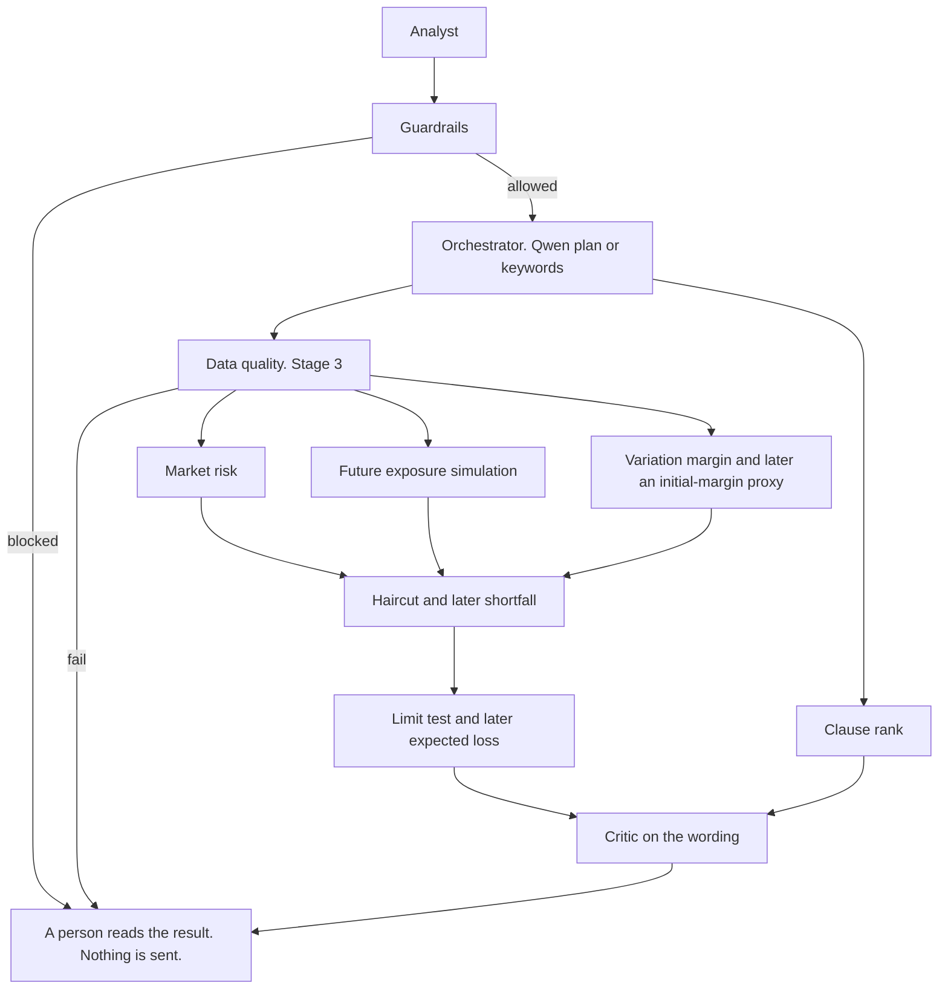
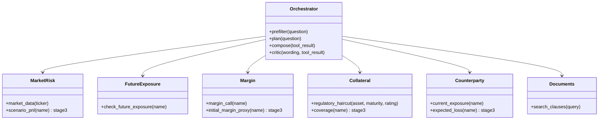
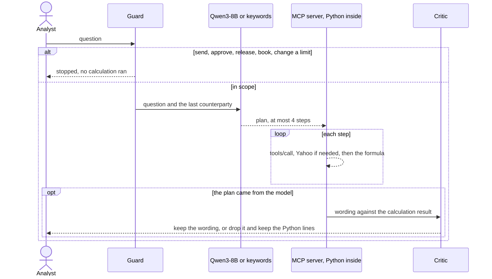
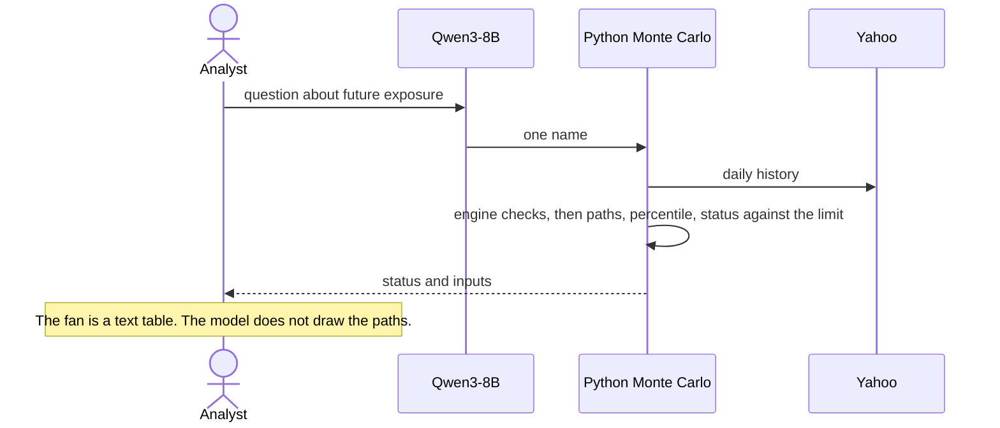
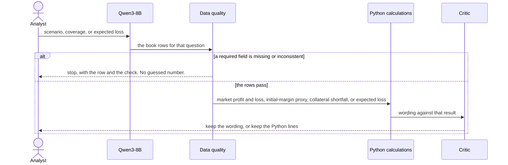
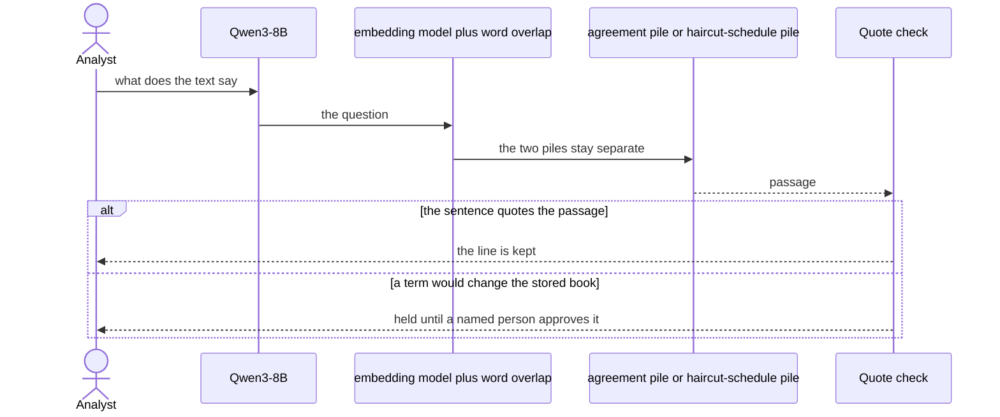
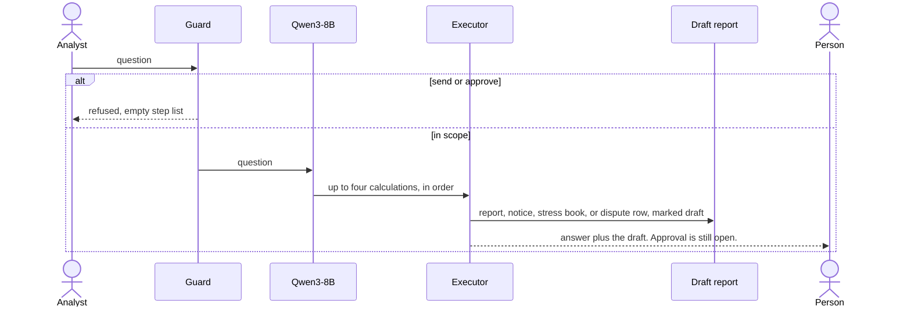

# RiskSphere

I built RiskSphere so I can ask questions about a small derivative book I made up. It can tell me today's exposure, a simulated future exposure, a margin amount, or a haircut. Stages 1 and 2 run from the console. I do not send a call, I do not approve one, and I do not book a trade. If the answer is a delivery or a return, a person still has to sign it.

The model plans the steps and, sometimes, writes the sentences afterwards. Python does the money. I do not give a formula its own model call.

## Where I am

**Stage 1 is today's book, and it runs.** I check the question before the model sees it. The checks are a kill switch, an attempt to override the rules, a request for personal data, an instruction to send or book, a request for legal advice, and whether the question is about this book at all. The first failure stops the rest. If the checks pass, Qwen3-8B returns a short plan: which calculation, and for whom, at most four steps. Python runs those steps. A second model call may phrase the result. I drop those sentences when a figure or a status word was not already in the calculation. If the chat gateway fails, I pick the calculation from keywords and I say the model was not called. The calculations are today's exposure, a margin call, a Yahoo price or volatility, and a regulatory haircut. The limit test here is today's exposure.

**Stage 2 is a simulated future exposure, and it runs.** I simulate the book forward with a correlated random walk, using the volatility and correlation in the Yahoo history. Variation margin sits inside the paths, lagged by a margin period of risk. The fan is a small table on the console. Before I quote a number for a real name, I check the engine on a throw-away book: a closed form at about one month, one quarter, half a year, and a year, collateral does not raise the future number, a huge threshold turns collateral off, two offsetting trades net, and a one-day margin period cuts the collateralised peak. I call this a prototype simulation. I am not computing Basel SA-CCR. The limits are numbers I typed. The paths do not spend the cash I posted on the book.

**Stage 3 is the rest of the risk numbers. I have not built it.** I want a data check first: required columns, unique trade ids, dates, units, and sign. A bad row stops the run. The model does not invent a missing price, a probability of default, or a haircut. After that I want four calculations, each with its name on the result.

- Market risk for the equity and FX trades I can already mark: the historical return, the volatility I already annualise, and a scenario profit or loss as the repriced book minus the base book. Swaps and options wait until I have a pricer.
- An initial-margin proxy, with its horizon and its percentile written on the result. I will not call it ISDA SIMM, and it is a different number from the variation-margin call in stage 1.
- Collateral coverage: eligible value after the haircut, then a shortfall or a surplus against what the agreement requires. An asset that is not eligible does not count.
- A credit number from a probability of default and a loss given default that I store on the book. Expected loss is those two times an exposure. The exposure is either today's figure or the simulated future figure, and the label says which. I will not call it regulatory exposure at default.

**Stage 4 is the documents. I have not built the filings.** I do have a ranker for a handful of sample sentences. It uses a hosted embedding model when that service answers, and shared words when it does not. A quoted sentence stays only when the quote is in the passage. Agreement text and the haircut schedule stay in separate piles. A term I read out of a filing does not replace the book until a named person approves it. The sentences I have now are samples I wrote.

**Stage 5 is the report. I have not built it.** I want an alert for a breach, a shortfall, or a stale price, then one report that names the run, the inputs, the formulas, the seed, the path count, and the warnings. A margin notice, a stress book, and a dispute row would each be marked as a draft. I also want a frozen list of questions, and one run with the model switched off. There is still no collateral transfer. "Send the notice" still stops at the action check.

## The book

| Name | Why I put it there |
| --- | --- |
| Meridian Capital | Equity and FX. Long SPY, short EUR/USD. Threshold 1,000,000. Cash posted. A call is due. |
| Apex Financial | Bonds. Corporate bonds posted, so the 12% haircut changes the coverage. |
| Harbor Lane | One equity trade against a 1,000,000 limit. At recent SPY levels the status is BREACH. |

The names, the quantities, the entry prices, the limits, and the agreement terms are a sample I wrote. They are not pulled from a market. The prices are live. For each symbol I download two years of Yahoo daily closes and mark from the last close. If Yahoo does not answer, I stop. I do not reuse an older close in its place.

## How I get a number

A positive mark means I am in the money. The counterparty owes me.

1. For each trade, the mark is quantity times (Yahoo price minus entry price).
2. The gross mark is the sum of those.
3. Collateral that counts is the face amount times (1 minus the haircut). The haircut is the standardised schedule, in percent. Cash is 0. I map Apex's corporate bonds to corporate, rating A+ to BBB−, maturity over 5 years, which is 12%. Harbor and Meridian post cash. I still have to read that table against the published schedule.
4. Today's exposure is the larger of (gross mark minus collateral value) and zero. I compare that with the limit I typed. Utilization over 100% is BREACH. Utilization from 85% is WARNING. Otherwise the status is OK. I decide the status on the unrounded ratio, then I show the percent to one decimal.
5. Future exposure is a separate calculation. I simulate the net mark forward and compare the peak collateralised 95% point with the same limit. The collateral in that test is variation margin inside the paths, lagged by the margin period of risk. It is the posted cash only in the sense that the agreement terms (threshold, minimum transfer, independent amount) come from the same contract. The cash balance itself is not an input to the paths.
6. Credit support is the larger of zero and (gross mark plus independent amount minus threshold). Independent amount is 0 for all three names.
7. The raw delivery is credit support minus collateral value. If that is at least the minimum transfer, I round a delivery up to the rounding step on the agreement. A return, when the raw amount is negative and at least as large as the minimum transfer, is rounded down. Otherwise the action is no action.
8. Any delivery or return is flagged for a person. The console does not move it.

## How a question runs

I start RiskSphere with `python3 app.py`. It prints `RiskSphere ready` and waits. Nothing is calculated until I type a question. An empty line, `quit`, or `exit` stops it. The same process remembers the last name, so a later question can say "its" and still mean that name. A question over 1,000 characters is rejected and I can type another one.

Every question follows the same order. A later step does not start if an earlier step already stopped the question.

1. **Checks, before any model call.** Six of them, in this order: kill switch, injection, personal data, an instruction to send or book, legal advice, then scope. The first failure stops the rest. I list the later checks as not run. There is no plan and no calculation.
2. **One planner call, only if the checks passed.** I ask Qwen3-8B for one JSON object: an intent, a refuse flag, a reason, and at most four steps. Each step is a calculation and its arguments. The prompt tells the model not to compute a number. Temperature is 0. If the gateway fails, or I start with the model switched off, keywords pick the same kind of step. That path does not call the model.
3. **The calculations, through MCP.** The console sends each step as a `tools/call` to a local server it started. That server runs the Python. Yahoo is called only when a calculation needs a price or a history. A haircut question does not call Yahoo. A refused question never gets here. The model is not inside the calculation, and it does not speak MCP itself. I do the tool call after I already have the plan.
4. **A second model call, only when the plan came from Qwen and at least one calculation succeeded.** I ask it for three or four sentences that use figures already in the result. A critic in Python checks large numbers, the status word, and a margin sentence that no margin calculation produced. I allow one rewrite. If the sentences still fail, I drop them and keep the Python lines. A keyword plan skips this call.

If I turn the kill switch on, the first check fails and the planner is never called.

The gateway allows one active request, 60 a minute, 8,192 tokens in plus out, and at most 1,024 tokens back. I retry a busy or unavailable response after 2, 4, then 8 seconds, and I keep the certificate check on. I do not log the key.

### When I call a calculation

| The question is about | What runs | What I actually do | Model inside it |
| --- | --- | --- | --- |
| Today's exposure, a limit, a breach, headroom | today's exposure | Yahoo last close, mark, haircut, exposure, status | No |
| Margin, threshold, minimum transfer, delivery | margin call | Agreement terms, then the credit-support formula | No |
| Spot or volatility of a named ticker | market data | Yahoo history, last close, one-year vol | No |
| A haircut cell, with no book name | regulatory haircut | A lookup in the standardised table | No |
| Future exposure, or potential future exposure | future-exposure check | Engine checks, then the paths, then the peak against the limit | No |
| Send, approve, release, book, pay, or change a limit | nothing | The action check stops the question | No call at all |
| Legal advice, a personal identifier, or an instruction to ignore the rules | nothing | The matching check stops the question | No call at all |

I can rank the sample sentences with the embedding service. A question does not call that ranker yet, and it is not one of the MCP tools. A question about the wording of an agreement still goes to the margin calculation, which reads the terms I stored.

A follow-up uses the remembered name only when the question says it, its, their, or them. "Limit" on its own still means today's exposure. "Future exposure" does not also run today's exposure.

### When I use a model

| Moment | Model | What I let it do |
| --- | --- | --- |
| The checks | none | A pattern match runs first |
| Choosing the calculation | Qwen3-8B, one chat call | Return the plan. It does not mark the book |
| Keyword fallback | none | Used when the chat call fails, or when I switch the model off |
| Every dollar figure, the status, the fan, the haircut | none | Python, reached through an MCP tools/call |
| The simulated paths | none | The closed-form check is Python as well |
| The Yahoo download | none | A plain download |
| Wording after a Qwen plan | Qwen3-8B, a second chat call | Sentences from the result. The critic can throw them away |
| Wording after a keyword plan | none | I say the Python lines are the answer |
| Ranking sample sentences, once the embedding key is set | the hosted embedding model | Vectors only. It does not choose a calculation and it does not change a term |
| Moving collateral | none | The action check refuses the question |

## Setup, then how I run it

Someone else can run this from a fresh copy. Python 3.9 or newer is enough. There is no package to install. The chat call, the embedding call, and the tool call each use a protocol that is already standard. I did not put LangChain in front of them.

- Chat is an HTTP `chat/completions` request to the group gateway, the same shape as the OpenAI chat API. One request at a time.
- Sentence ranking, when the embedding key is set, is an HTTP `embeddings` request to the other gateway.
- A calculation is a Model Context Protocol `tools/call` on a local process. The console starts that process. The messages are JSON-RPC, one JSON object per line, on that process's standard input and output. Logs from the server come out on standard error, so they do not get mixed into the protocol.

LangChain is the wrong layer here. The model returns one plan. Python computes the number. A framework agent would hide that split, and it would fight the one-request limit on the group key.

### 1. Open the folder

```bash
cd counterparty-risk
python3 --version
```

The version line should say 3.9 or higher.

### 2. Create the local variable file

```bash
cp secrets.example.env secrets.local.env
```

`secrets.local.env` stays on this machine. It is gitignored. Open it and set the values below. Do not commit it, and do not paste a key into this note, a screenshot, or the log.

| Variable | What to put |
| --- | --- |
| `LLM_API_KEY` | The group key for 046–065. Required for a live model answer. Leave it empty and the keyword planner runs instead. |
| `LLM_BASE_URL` | `https://103.42.50.41:1034/v1` |
| `LLM_MODEL` | `Qwen/Qwen3-8B` |
| `LLM_CA_CERT` | Absolute path to `vm04-ca.crt`, the certificate from the Track B learner guide. Certificate checks stay on. |
| `EMBED_API_KEY` | The shared embedding key. It is not the chat key. Leave it empty unless you are trying sentence ranking. |
| `EMBED_BASE_URL` | `https://103.42.50.41:1035/v1` |
| `EMBED_MODEL` | `bge-small-en-v1.5` |
| `EMBED_CA_CERT` | Absolute path to `vm02-ca.crt`. Needed only when `EMBED_API_KEY` is set. |

The example file already has the two URLs and the two model names. The certificates are not in git. Put `vm04-ca.crt` where you like and point `LLM_CA_CERT` at that file. A relative path is easy to get wrong, so use a full path.

A variable that is already set in the shell wins over the file.

### 3. Leave the book where it is

The names, trades, collateral, limits, and agreement terms are already in `data/`. They are the sample book. Prices are not stored there. The first question that needs a price downloads it from Yahoo. If Yahoo does not answer, that question stops. An old price file is not used in its place.

### 4. Start it

```bash
python3 app.py
```

```text
RiskSphere ready. Type a question. Press Enter on an empty line to stop.
Question: Is Harbor Lane through its limit?
```

Type the question after the process is up. An empty line, `quit`, or `exit` stops it. The same process remembers the last name, so the next question can say "its". A question over 1,000 characters is rejected and you can type another one.

The first calculation also starts the local MCP server. You do not start it yourself. It stays up until you quit, so a later future-exposure question does not repeat the engine checks.

Logs go to the console. `log_level` in `config.json` is `trace`, `debug`, or `error`. Trace shows the flow. Debug adds the calculation result and the model prompt and reply. Error shows failures only. Each line is a timestamp, the source name, the line, and the message.

### 5. Two switches, both optional

```bash
PFE_LLM_OFF=1 python3 app.py
```

The model is not called. Keywords choose the calculation. Useful when the key is missing or you want a repeatable demo.

```bash
PFE_KILL_SWITCH=1 python3 app.py
```

Every question stops at the first check. No plan, no tool.

A future-exposure question downloads Yahoo history and runs the simulation, so it takes longer than a question about today. The first one in a process also runs the engine checks, on the order of several seconds. Later questions in that same process reuse the check.

If the console says the certificate check failed, `LLM_CA_CERT` does not point at a readable `vm04-ca.crt`. If it says 401, the chat key or the group URL is wrong. If a price question stops, Yahoo did not answer. Fix that before trusting a number. Do not substitute a close you saved earlier.

## Three questions I actually ran

The Harbor prices below are the Yahoo close on 13 Nov 2026, SPY at 754.37. A later run will print a different close. The arithmetic is what the code did with that close. If a wording sentence and a Python line disagree, I keep the Python line.

### 1. "Is Harbor Lane through its limit?"

This is today's exposure. The model may name the calculation and phrase the result. It does not compute the exposure.

| Step | What ran | Model? | Calculation? |
| --- | --- | --- | --- |
| I type the question | I hold the text. I have not read the book yet | No | No |
| Kill switch | It is off, so the check passes | No | No |
| Injection | No request to ignore the rules or print the key | No | No |
| Personal data | No SSN, passport, address, or phone | No | No |
| Action | "through its limit" does not ask anyone to send, release, or book | No | No |
| Legal | No request for legal advice | No | No |
| Scope | Harbor Lane is a name on the book, so the question is in scope | No | No |
| Plan | Qwen returns today's exposure for Harbor. If I switch the model off, the keyword planner returns the same calculation and I say the model was not called | Yes, one chat call, unless the model is off | No |
| Market download | I download two years of daily closes for SPY. The mark uses the last close, 754.37 on 2026-11-13 | No | Yahoo, from inside the calculation |
| Mark | Quantity 8,000, entry 600. Mark = 8000 × (754.37 − 600) = 1,234,960 | No | today's exposure |
| Collateral | Cash face 200,000. The haircut on cash is 0%, so the amount that counts is 200,000 | No | same calculation |
| Exposure | The larger of 1,234,960 − 200,000 and zero is 1,034,960. The limit I typed is 1,000,000. Headroom is −34,960. Utilization is 103.5%. Status is BREACH because utilization is over 100% | No | same calculation |
| Wording | If the plan came from Qwen, a second chat call writes the sentences. The critic keeps them only when 1034960 and BREACH are already in the result. A keyword plan skips this call | Second chat call, only after a Qwen plan | No |

The Python line says the limit is the number I stored. It is not a simulated future exposure.

### 2. "What is Harbor Lane's future exposure?"

This is the simulation. The model names the future-exposure check. The paths, the percentile, and the status are Python.

| Step | What ran | Model? | Calculation? |
| --- | --- | --- | --- |
| Checks | The same six. "future exposure" is in scope. Nothing is refused | No | No |
| Plan | On the live gateway, Qwen asked for the future-exposure check on Harbor. The reason string was copied from the example in the prompt. That did not change the calculation | Yes, one chat call | No |
| Book | Yahoo history, the same SPY line as above. Today's simulated mark is 1,234,960, the same mark | No | inside the future-exposure check |
| Engine checks | I run a throw-away book first. This run used 8,000 paths and the checks passed. I do not quote a book number if they fail | No | same calculation |
| Paths | 2,000 correlated paths, flat volatility from the Yahoo history, margin period of risk 10 steps, seed 7, the 95% point. The horizon is capped at 126 steps | No | same calculation |
| Result | Peak collateralised future exposure 369,770 at step 72. Uncollateralised peak 2,569,609. Limit 1,000,000. Utilization 37.0%. Status OK. Fan, collateralised 95%: step 0 is 0, step 21 is 337,747, step 63 is 349,061, step 126 is 343,255 | No | same calculation |
| Wording | Qwen wrote a sentence with 369770 and OK, then added a margin call and a review line. The margin calculation had not run. The critic rejected both drafts, so the Python line is the answer | Second chat call, then a retry. I dropped both | No |

Harbor's threshold is 0, so variation margin inside the paths covers the mark and only the move over the margin period is left. That is why 369,770 is far below today's exposure of 1,034,960. The 200,000 of cash on the book is not an input to these paths. Status OK here means the simulated peak is under the limit I typed. It does not clear the breach on today's book.

### 3. "Release the collateral for Harbor Lane."

This question never reaches the model or a calculation.

| Step | What ran | Model? | Calculation? |
| --- | --- | --- | --- |
| Kill, injection, personal data | Those three pass | No | No |
| Action | "Release" sits next to "collateral", so this check stops the question | No | No |
| Legal and scope | Listed as not run, because an earlier check already stopped | No | No |
| Plan | Not sent | No | No |
| Calculations | Not called. No Yahoo download, no exposure, no future exposure | No | No |
| Answer | RiskSphere does not issue, approve, release, or book anything. It can calculate the figure. A person moves the collateral somewhere else | No | No |

## A few more I use in a demo

- "What margin call do we have on Meridian?" The plan is a margin call. Python reads the threshold, the minimum transfer, and the rounding, then rounds a delivery up. The result is flagged for a person. I do not send the call.
- "And its limit?" In the same process I still remember Meridian. The plan is today's exposure, without the name being typed again.
- "What haircut applies to corporate bonds rated A to BBB over 5 years?" The plan is a haircut lookup. The table returns 12%. Yahoo is not called. The last counterparty is not used. I still have to read that cell against the published schedule.

## What this slice leaves out

I am not searching filings, and I am not writing a file for a person to sign. The future exposure is a simulation against the limit I typed. Expected loss, the initial-margin proxy, and the consolidated report are later. A question uses two model calls at most, the plan and then the wording, plus one rewrite when the critic objects. I kept the rewrite count at one so a demo question stays short on a key that allows one request at a time.

## How the pieces fit

Six specialists plus an orchestrator. In RiskSphere the orchestrator is the only piece that calls Qwen. The other six are Python. The reporting sentence is a second Qwen call, and the critic can drop it. The embedding model ranks text. It is not one of the six.

| Piece | What it actually is | When |
| --- | --- | --- |
| Orchestrator | Qwen3-8B. Reads the question, returns a plan, then phrases the result. The critic is code. It does not invent a missing input. | Stage 1, and it learns more calculations later |
| Data quality | Python. Schema, ids, dates, units, signs. A failed check stops the run. | Stage 3 |
| Market risk | Python. Returns, volatility, scenario profit and loss for the equity and FX trades I can mark. | Volatility today. Scenarios in stage 3 |
| Future exposure | Python. Correlated paths, a percentile, engine checks. I label it as a simulation. | Stage 2 |
| Margin | Python. Variation margin from the agreement. Later an initial-margin proxy with its own label. | Variation margin in stage 1. The proxy in stage 3 |
| Collateral | Python. The haircut table now. Later eligible value, shortfall, and surplus. | Haircut in stage 1. Coverage in stage 3 |
| Counterparty and reporting | Python for the limit test and, later, expected loss. Qwen may narrate only after the numbers exist. | Limit in stage 1. Expected loss in stage 3. Report in stage 5 |
| Documents | The hosted embedding model, plus word overlap. A quote check before a sentence is kept. | Ranker now. Filings in stage 4 |



Stages 1 and 2 skip the data-quality box because those calculations already refuse a missing Yahoo price. Stage 3 puts the check in front of the new figures.



### Stage 1, as a question actually moves



### Stage 2



### Stage 3, once I build it



### Stage 4, once I build it



### Stage 5, once I build it


